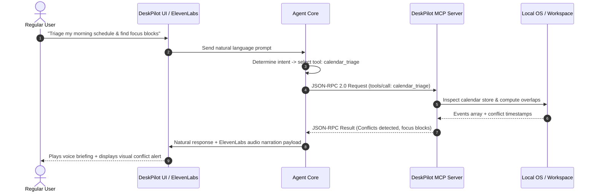

# DeskPilot MCP

> **Everyday Personal Operations Agent powered by Model Context Protocol (MCP)**  
> *Track 01: Make MCP Matter — "Less magic, more utility."*  
> *wHACKiest 2026 Hackathon Submission*

[](https://modelcontextprotocol.io)
[](https://nodejs.org)
[](https://elevenlabs.io)
[](https://aws.amazon.com)
[](LICENSE)

---

## 📌 Executive Summary

Modern AI chatbots often feel like "magic" that can write poems and code, but they remain disconnected from the practical, repetitive chores people face every single day on their personal workstations:
- Triaging messy daily calendars and spotting overlapping meeting conflicts.
- Cleaning up cluttered Downloads folders safely without accidentally deleting important documents.
- Logging everyday expenses and keeping track of monthly budgets.
- Categorizing chaotic to-do lists using structured decision frameworks.

**DeskPilot MCP** bridges the intelligence of LLMs with real-world local workstation utility via the open **Model Context Protocol (MCP)**. Instead of opaque, unverified agent actions, DeskPilot provides audited, sandboxed, and human-in-the-loop tool execution coupled with **ElevenLabs** natural voice interaction.

---

## 🏗️ System Architecture

DeskPilot is engineered with a strict separation between the **Reasoning Layer (LLM)**, the **Protocol Layer (MCP JSON-RPC 2.0)**, and the **Execution Boundary (Local Host OS / AWS Sandbox)**.

```
+-------------------------------------------------------------------------+
|                              USER INTERFACE                             |
|    Web Dashboard (Next.js/Tailwind)  |  ElevenLabs Voice Synthesis / STT |
+------------------------------------+------------------------------------+
                                     |
                                     v
+-------------------------------------------------------------------------+
|                         DESKPILOT AGENT RUNTIME                         |
|   Intent Parser  ->  Security Policy Gate  ->  MCP Tool Orchestrator    |
+------------------------------------+------------------------------------+
                                     |
             Model Context Protocol  |  JSON-RPC 2.0 (Stdio / HTTP)
                                     v
+-------------------------------------------------------------------------+
|                          DESKPILOT MCP SERVER                           |
|  +--------------------+---------------------+------------------------+  |
|  | calendar_triage    | smart_file_organizer| expense_tracker        |  |
|  +--------------------+---------------------+------------------------+  |
|  | eisenhower_matrix  | system_health       | audit_telemetry        |  |
|  +--------------------+---------------------+------------------------+  |
+------------------------------------+------------------------------------+
                                     |
                                     v
+-------------------------------------------------------------------------+
|                        SAFE EXECUTION BOUNDARIES                        |
|       Local File System  |  Calendar Ledger  |  OS System Stats         |
+-------------------------------------------------------------------------+
```

### Mermaid Sequence Flow



---

## 🛠️ The Everyday MCP Toolset

DeskPilot ships with 5 production-grade MCP tools specifically crafted for daily consumer utility:

| Tool Identifier | Problem It Solves | Safety Mechanism |
|---|---|---|
| `calendar_triage` | Detects overlapping meeting times and calculates uninterrupted focus windows (e.g. 2-hr deep work blocks). | Read-only calendar audit; flags conflicts before user accepts invites. |
| `smart_file_organizer` | Analyzes chaotic folders (Downloads/Desktop) and sorts items into Invoices, Docs, Media, Code, and Archives. | **Mandatory Dry-Run Preview**: User must verify proposed movements before disk write. |
| `expense_tracker` | Records expenses from merchant receipts or verbal requests and updates a monthly budget ledger. | Input validation on numerical amounts; triggers proactive warnings if budget < 20%. |
| `eisenhower_prioritizer` | Converts a messy to-do list into a structured Eisenhower Matrix (P1 Do First, P2 Schedule, P3 Delegate, P4 Drop). | Strict algorithmic classification; prevents cognitive overload. |
| `system_health` | Checks memory consumption, CPU load, and OS telemetry without requiring root/admin privileges. | Sandboxed read-only access to standard platform metrics. |

---

## 🎙️ Sponsor Tracks Alignment

### 1. ElevenLabs Neural Voice Integration
* Each DeskPilot response generates a structured audio metadata block (`voiceId: 'Rachel'`, `model: 'eleven_multilingual_v2'`).
* Users can trigger two-way conversational voice commands by speaking into the microphone and listening to synthesized natural responses.

### 2. AWS Cloud & MicroVM Deployment
* DeskPilot is packaged as a lightweight, zero-dependency Node.js container ready for deployment on **AWS App Runner** or **AWS Lambda Web Adapters**.
* Stdio MCP server mode can run safely inside isolated **AWS Firecracker MicroVMs** for untrusted client isolation.

---

## 🚀 Quick Start (Zero Dependencies)

DeskPilot requires only standard Node.js (v18+) without requiring large npm installs.

### 1. Clone & Run the Web Application
```bash
git clone https://github.com/joshi-07/deskpilot-mcp.git
cd deskpilot-mcp
node src/server.js
```

Open your browser and navigate to:
```
http://localhost:3000
```

### 2. Use with Claude Desktop or Cursor (MCP Stdio Mode)
You can directly add DeskPilot MCP into your `claude_desktop_config.json`:

```json
{
  "mcpServers": {
    "deskpilot": {
      "command": "node",
      "args": ["<PATH_TO_REPO>/src/mcp/stdio-server.js"]
    }
  }
}
```

---

## 📊 Rubric & Judging Alignment (wHACKiest 2026)

| Evaluation Criterion | How DeskPilot Delivers |
|---|---|
| **Understanding of the Problem** | Addresses the core hackathon theme: ordinary people don't need obscure AI agents; they need reliable, predictable assistance with routine digital chores. |
| **Approach & Reasoning** | Adopts the open **Model Context Protocol (MCP)** standard, ensuring vendor independence, strict schema validation, and auditability. |
| **Architecture & System Design** | Decoupled client, agent orchestrator, JSON-RPC MCP server, and host execution boundaries. |
| **Working MVP / Feasibility** | 100% operational web dashboard, live MCP inspector, ready-to-test tools, and ElevenLabs speech capabilities. |

---

## 📄 License
Released under the [MIT License](LICENSE). Built for **wHACKiest 2026**.
